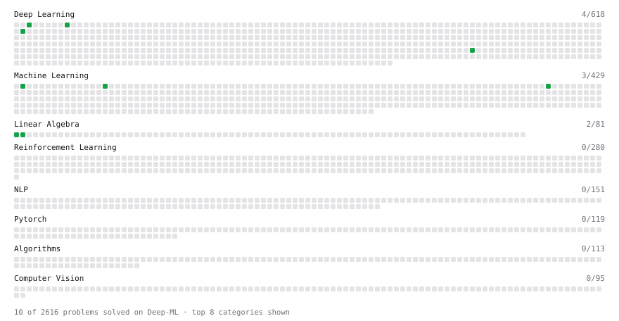

# Deep-ML

My machine learning practice from [Deep-ML](https://www.deep-ml.com). Every solution here was written by hand.

**13** solved · 9 problems · 0 labs · 4 math

[**Browse the interactive portfolio**](https://justinjerrick2209.github.io/deep-ml/) to replay this filling in over time.

## Problems

| | Difficulty | Solved | |
| --- | --- | --- | --- |
| [Calculate Number of Parameters in Neural Network](https://www.deep-ml.com/problems/371) | easy | 2026-11-17 | [solution](problems/0371-calculate-number-of-parameters-in-neural-network) |
| [Gradient Direction and Magnitude](https://www.deep-ml.com/problems/308) | easy | 2026-11-23 | [solution](problems/0308-gradient-direction-and-magnitude) |
| [Implement ReLU Activation Function](https://www.deep-ml.com/problems/42) | easy | 2026-11-22 | [solution](problems/0042-implement-relu-activation-function) |
| [Linear Regression Using Gradient Descent](https://www.deep-ml.com/problems/15) | easy | 2026-11-23 | [solution](problems/0015-linear-regression-using-gradient-descent) |
| [Matrix-Vector Dot Product](https://www.deep-ml.com/problems/1) | easy | 2026-11-15 | [solution](problems/0001-matrix-vector-dot-product) |
| [Run the Digit Network Forward](https://www.deep-ml.com/problems/1994) | easy | 2026-11-17 | [solution](problems/1994-run-the-digit-network-forward) |
| [Single Neuron](https://www.deep-ml.com/problems/24) | easy | 2026-11-17 | [solution](problems/0024-single-neuron) |
| [Transpose of a Matrix](https://www.deep-ml.com/problems/2) | easy | 2026-11-15 | [solution](problems/0002-transpose-of-a-matrix) |
| [Find Captain Redbeard's Hidden Treasure](https://www.deep-ml.com/problems/127) | medium | 2026-11-18 | [solution](problems/0127-find-captain-redbeard-s-hidden-treasure) |

## Math

| | Difficulty | Solved | |
| --- | --- | --- | --- |
| [Derivatives and Gradients](https://www.deep-ml.com/math-problems/1) | easy | 2026-11-15 | [solution](math/0001-derivatives-and-gradients) |
| [ML Workflow Basics](https://www.deep-ml.com/math-problems/30) | easy | 2026-11-15 | [solution](math/0030-ml-workflow-basics) |
| [Vector Operations](https://www.deep-ml.com/math-problems/7) | easy | 2026-11-15 | [solution](math/0007-vector-operations) |
| [Matrix Multiplication](https://www.deep-ml.com/math-problems/10) | medium | 2026-11-15 | [solution](math/0010-matrix-multiplication) |

---

_This file is regenerated by Deep-ML on every push._
